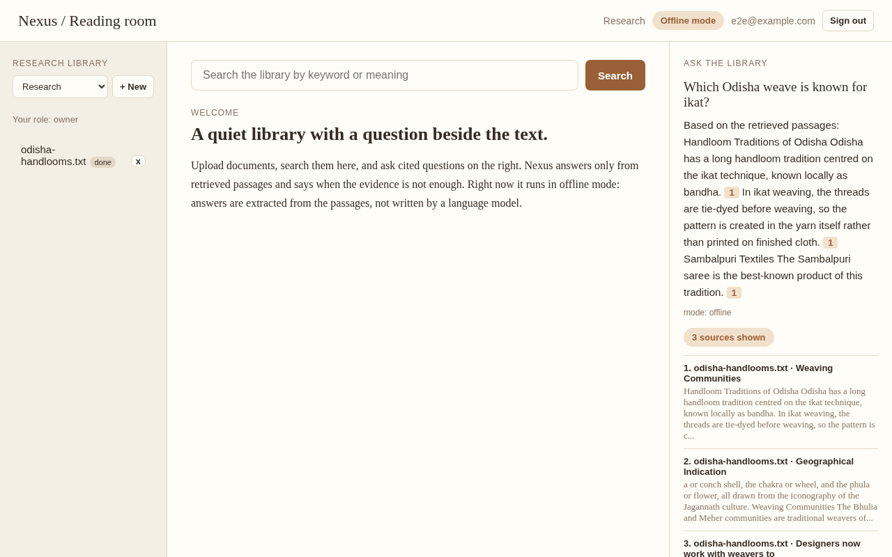
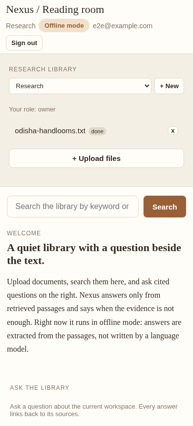

# Nexus

A document research engine built as a learning project. Upload documents, search them with hybrid retrieval, and ask
questions. Answers cite the exact passages they came from, and Nexus says so when the documents do not contain the answer.

Stack: React, FastAPI, PostgreSQL with pgvector, Redis and Celery, S3-compatible object storage, sentence-transformers
embeddings, and the Claude API (see "What is and is not verified" for what has actually been run).

## What is and is not verified

Read this first. It is the honest status of each claim.

| Piece | Status |
|---|---|
| Retrieval, chunking, abstention, citations, auth, ingestion reliability | Tested (automated tests and the evaluation below). |
| PostgreSQL 16 + pgvector 0.6.2 | Tested locally on a real server started with pip (`scripts/test_on_postgres.py`). Not a hosted database. |
| Redis + Celery worker | Tested locally with a real Redis 6.2 and a real Celery worker process. |
| S3 storage | Tested against moto, an S3-compatible server. **Not tested against AWS S3.** |
| Claude API | **Not tested with a real key.** The code path is tested with a fake client only. The app runs in offline mode (answers built from retrieved sentences) unless `ANTHROPIC_API_KEY` is set, and the UI says which mode is active. |
| Docker / docker-compose | Files written and YAML-checked. **Docker was not available where this was built, so they have never been built or run.** |
| GitHub Actions CI | Ran on GitHub for commit dc37d19: lint, SQLite tests, tests against a pgvector Postgres service, and frontend tests/build all passed (https://github.com/manishoutr/nexus/actions/runs/45029088385). The first run failed because `alembic` was missing from requirements.txt; fixed. |
| Live demo | Runs an older light build (hashing embeddings, SQLite). It does not have the upgrades described here yet. |

## What it does

1. **Accounts and workspaces.** Register, sign in, create private workspaces, add members as viewer or editor. A public
   demo workspace can be read without an account.
2. **Upload.** PDF, DOCX, TXT and Markdown, validated by content. The same bytes uploaded twice are stored once.
3. **Background ingestion.** Extract, chunk (about 600 characters with overlap, page and section kept), embed, store.
   Atomic job claims, retries with backoff, recovery of jobs from dead workers. A Celery + Redis queue is available.
4. **Hybrid retrieval.** BM25 and vector search merged with reciprocal rank fusion, with an optional cross-encoder
   reranker. With PostgreSQL the vector search runs inside the database (pgvector, HNSW index).
5. **Grounded answers with citations.** Every answer cites document and page or section. Citations are checked against
   what was retrieved.
6. **Abstention.** If the evidence is weak the answer says so instead of guessing.
7. **Prompt-injection defense in depth.** Passages are treated as untrusted data and instruction-like sentences are
   removed. This is a heuristic filter, not a guarantee.




## Quickstart (no API key, no extra services)

```bash
python -m venv .venv && source .venv/bin/activate
pip install -r requirements.txt            # light build: hashing embeddings
python run.py                              # http://localhost:8000
```
The React app is already built into `app/static`. To change it: `cd frontend && npm install && npm run dev`
(proxies `/api` to port 8000), then `npm run build`.

For real embeddings and the reranker: `pip install -r requirements-ml.txt` (pulls torch, large) and set
`EMBEDDING_BACKEND=st`. Full environment reference: `docs/ENVIRONMENT.md`.

### Full stack
```bash
JWT_SECRET=$(python -c "import secrets;print(secrets.token_urlsafe(48))") docker compose up --build
```
Starts the API, a Celery worker and beat, PostgreSQL with pgvector, Redis and MinIO. **Not yet run, see above.**
Without Docker, the same pieces can be started as separate processes; `tests/integration` does exactly that.

### Production settings
Set `APP_ENV=production` and a `JWT_SECRET` of 32+ random characters; the app refuses to start otherwise. Use PostgreSQL
with pgvector, a shared `RATE_LIMIT_STORAGE` (Redis) if you run more than one process, and persistent object storage
(local disk is ephemeral on most free hosts). Deploy notes and memory needs: `docs/ENVIRONMENT.md`.

## Tests

```bash
pip install -r requirements-dev.txt
python -m pytest                           # SQLite, plus real Redis/Celery/S3(moto) integration tests
python scripts/test_on_postgres.py         # the suite on a real PostgreSQL + pgvector
cd frontend && npm test                    # React tests (vitest)
ruff check .
```
Last local run: 93 passed and 5 skipped on SQLite (the skipped ones need Postgres), 91 passed on PostgreSQL,
9 frontend tests passed, ruff clean. An end-to-end run in a real headless Chrome registered a user, created a workspace,
uploaded a file, waited for ingestion and asked a question.

## Evaluation

`python -m eval.run --backend hash|st [--rerank]` ingests 3 seed documents plus 5 distractor documents (22 chunks) and
runs 56 questions: single-fact, multi-document, paraphrased, unanswerable-but-related, and unanswerable-unrelated.
Offline answer mode, no network. Results are in `eval/results/` and shown at `/eval.html`.

| System | Hybrid MRR | Abstention accuracy (all / held-out test) | Unanswerable questions wrongly answered | Answerable questions wrongly refused |
|---|---|---|---|---|
| Hashing embeddings | 0.902 | 76.8% / 71.9% | 75.0% | 2.5% |
| MiniLM embeddings | 0.908 | 78.6% / 75.0% | 75.0% | 0.0% |
| MiniLM + cross-encoder gate | 0.963 | 89.3% / 87.5% | 18.8% | 7.5% |

BM25 alone scores MRR 0.933 on this set, which is higher than hybrid for the first two rows; the questions are short and
share words with their passages. Thresholds were tuned on the dev split only; the "held-out test" column was not used for
tuning. The dataset is small and written by the developer, so these are directional numbers, not benchmarks. Without the
reranker, three quarters of related-but-unanswerable questions still get an answer.

## Architecture and API
- `docs/ARCHITECTURE.md`: diagram, request paths, data model.
- `docs/API.md`: every endpoint, roles, error codes, curl example.
- `docs/ENVIRONMENT.md`: settings and deployment requirements.
- `docs/UPGRADE_LOG.md`: the engineering upgrade, phase by phase, with test numbers and what was not proven.

## Design decisions worth being able to explain
- **The jobs table is the queue.** Claims are one conditional UPDATE, so exactly one worker runs a job. The same function
  runs under the threaded poller or Celery.
- **Rank fusion plus a separate strength signal.** RRF only encodes rank, so it cannot say "nothing relevant". Abstention
  uses an absolute score instead.
- **The model never does retrieval and has no tools.** Code finds the evidence; the model only phrases an answer.
- **Not-found and forbidden look the same** for private workspaces, so ids cannot be probed.
- **Migrations are idempotent**, so a database created before Alembic is adopted without data loss.

## Known limitations
- No real Claude call has been made. Claude mode is unverified end to end.
- S3 was tested against moto, not AWS. Docker files and CI have not been executed (see the table).
- Refresh tokens cannot be revoked, there is no password reset and no email verification. Tokens are kept in
  `localStorage`, which any script on the page could read.
- The injection filter is a list of known phrasings. A determined attacker can phrase around it.
- Offline answers are extracted sentences, not written prose. Without the reranker, abstention on related-but-unanswerable
  questions is weak (table above).
- The evaluation set is small (56 questions) and written by one person.
- Rate limits are per process unless `RATE_LIMIT_STORAGE` points at Redis; sharing was tested only at the storage layer.
- No test kills a Celery worker with `kill -9` mid-job; recovery is tested by simulating the dead claim.
- DOCX and TXT have no real page numbers; their citations use sections.
- The sentence-transformers build needs torch. It is expected not to fit a 512 MB free host (not measured).
