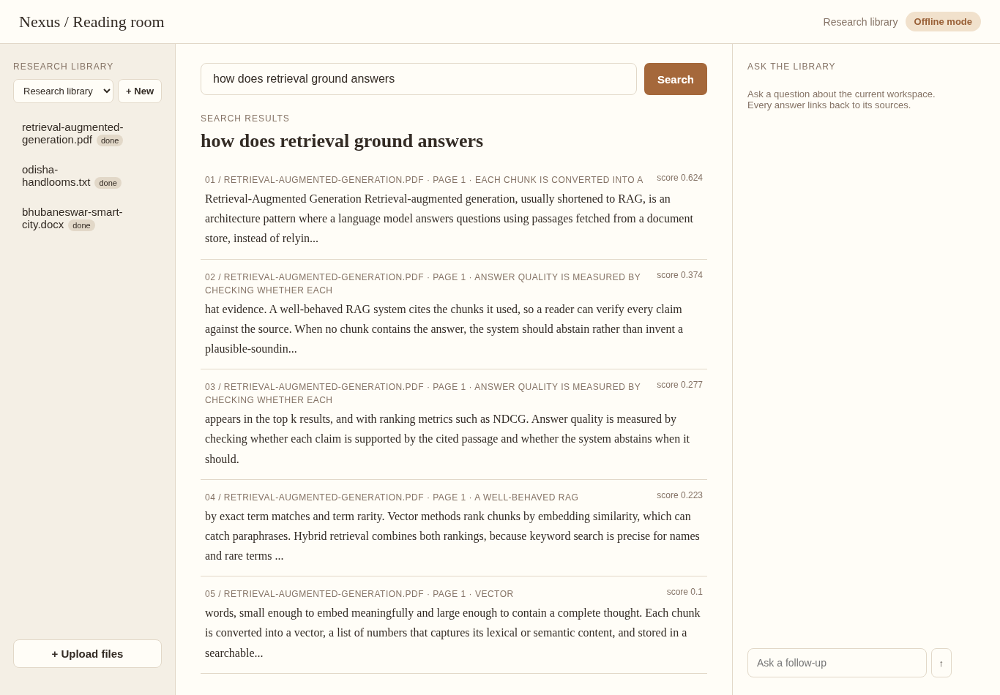
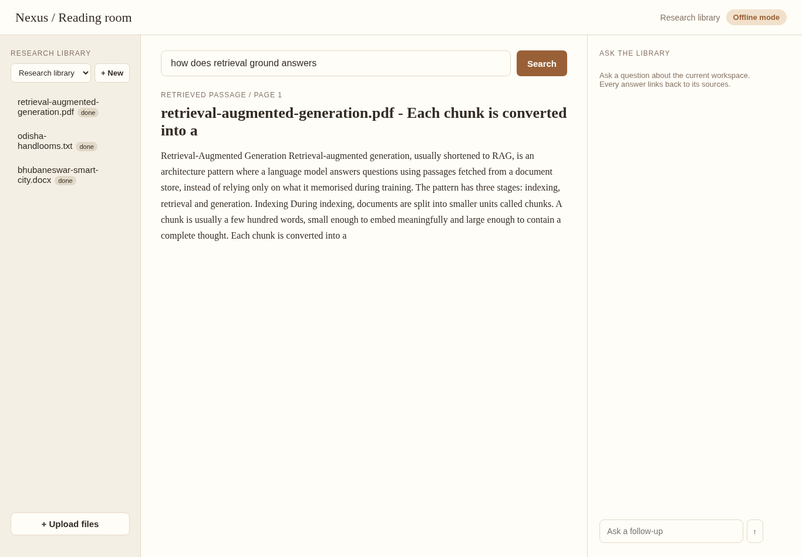
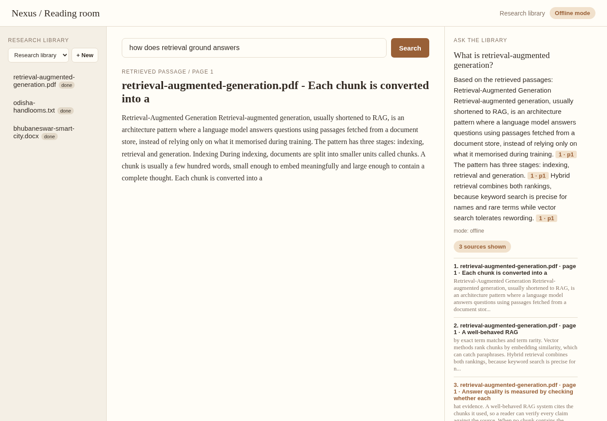

# Nexus

An AI knowledge and research engine, built as a learning project. Upload a
collection of documents, search across them with hybrid retrieval, and ask
questions with answers grounded in - and cited back to - the exact source
passages.

> Learning-project notes are inline across the codebase. This README explains
> what is built, why it is built that way, and what is deliberately left out.

## What it does

1. **Workspaces and upload** - create a workspace, upload PDF / DOCX / TXT
   files (type and size validated, originals stored locally).
2. **Asynchronous ingestion** - a durable job queue (database-backed) with a
   background worker: extract text, split into chunks, embed, store.
   Failures retry up to 3 attempts, then are marked failed with the error.
3. **Chunking with metadata** - sentence-aware ~600-character chunks with
   ~120-character overlap; every chunk keeps its document, page and section.
4. **Hybrid retrieval** - BM25 keyword scoring + vector cosine similarity,
   merged with min-max normalization.
5. **Grounded Q&A with citations** - answers are built only from retrieved
   passages and cite document + page/section for every claim.
6. **Abstention** - when the best passage scores below a documented
   threshold, Nexus says it does not have enough evidence instead of
   inventing an answer.

## Live demo

https://nexus-pkju.onrender.com

Hosted on Render's free tier in offline mode (no API key): answers are
extractive fallbacks built only from the retrieved passages. A demo
"Research library" workspace is seeded on first boot. Free-tier notes: the
service sleeps after 15 minutes idle (first load can take about a minute to
wake), and uploaded documents are ephemeral - they reset on redeploy or
restart.

## Screenshots







## Quickstart (5 minutes, no API key needed)

```bash
python -m venv .venv && source .venv/bin/activate
pip install -r requirements.txt
python scripts/make_seed_docs.py   # optional: PDF + DOCX seed documents
python run.py                      # http://localhost:8000
```

Demo path:

1. Open http://localhost:8000. On first boot Nexus creates a "Research
   library" workspace and ingests the three files in `seed_docs/` (TXT, PDF
   and DOCX - one of each format), exactly like user uploads; watch their
   status move pending -> done. You can also create more workspaces and
   upload your own files.
2. **Search** for "hybrid retrieval" and open the ranked passages.
3. **Ask** "Why combine keyword and vector search?" and check that each
   claim in the answer cites a document and page/section.
4. **Ask** something unrelated ("Who won the 1998 world cup final?") and
   watch Nexus abstain instead of guessing.

Run the tests:

```bash
pip install -r requirements-dev.txt
pytest
```

## Claude integration

The app uses the Anthropic Messages API behind a single service layer
(`app/services/llm.py`). Set `ANTHROPIC_API_KEY` (see `.env.example`) and
answers are generated by Claude from the retrieved passages with strict
answer-only-from-evidence instructions; the output is schema-validated and
the citations it claims are checked against what was actually retrieved.

**Without a key the app runs in OFFLINE mode**: answers are assembled
deterministically from the top retrieved sentences and labelled `offline`.
Retrieval, chunking, citations and abstention are identical in both modes -
the LLM only ever phrases an answer over evidence the pipeline already found.

## Architecture

```
app/
  main.py               FastAPI routes + reliability metrics
  config.py             environment-driven settings
  db.py / models.py     SQLAlchemy; jobs table doubles as the queue
  schemas.py            API contracts
  services/
    extract.py          PDF (page-aware) / DOCX / TXT -> (page, text) pairs
    chunk.py            sentence-aware overlapping chunks with metadata
    embeddings.py       deterministic hashing embeddings (256-dim, no network)
    retrieval.py        BM25 + vector hybrid, min-max merged
    worker.py           threaded ingestion worker with retries (Celery-ready)
    qa.py               retrieve -> abstain-or-answer -> cite
    llm.py              the only file that talks to the Anthropic SDK
  static/               zero-build frontend (vanilla JS, served by FastAPI)
seed_docs/              three demo documents (TXT/PDF/DOCX)
tests/                  chunking, extraction, retrieval, Q&A grounding, API flow
```

Data storage defaults to SQLite. Set `DATABASE_URL=postgresql+psycopg2://...`
for PostgreSQL; `docker-compose.yml` includes an optional `pgvector` profile.

## Engineering decisions worth explaining in an interview

- **The jobs table is the queue.** Uploads never block on processing, the
  worker survives restarts, and every failure is inspectable in the API. In
  production the same `process_document()` drops into Celery/Redis unchanged
  - the task boundary was designed for that swap.
- **Abstention is measured, not hoped for.** `/api/metrics` counts
  abstentions separately, and the threshold is a named constant you can tune
  and evaluate.
- **Citations are structural, not decorative.** A citation is the chunk's
  stored metadata (document, page, section), so it cannot drift from what
  was actually retrieved.
- **The LLM never does retrieval.** Search indexes and plain code find the
  evidence; the model only phrases the answer. That is what makes the
  no-outside-knowledge rule enforceable.

## Known limitations (honest list)

- Hashing embeddings capture lexical overlap, not deep semantics. Swapping
  in a real embedding model means replacing `embed()` and re-ingesting.
- Retrieval merges two normalized rankings with a fixed weight; a learned
  reranker would improve ordering on harder queries.
- Offline-mode abstention is a retrieval-score threshold: a question sharing
  common words with a document (e.g. "capital") can pass it and get a generic
  answer composed from the top passage. Claude mode judges relevance instead.
- DOCX/TXT have no real page numbers; their citations use sections instead.
- The threaded worker processes one job at a time; concurrent uploads queue.
  Horizontal scaling is the Celery swap described above.
- No authentication: workspaces are shared by everyone on the instance.
