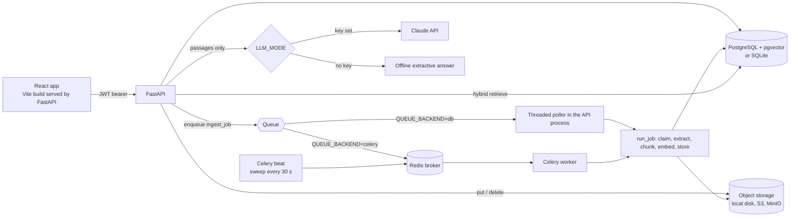

# Architecture



## Request paths

**Upload.** Validate by content, hash (sha256), store the original, insert a `documents` row and an `ingestion_jobs` row,
return 201. Nothing slow happens in the request.

**Ingest (`worker.run_job`).** Atomically claim the job (`UPDATE ... WHERE status='pending'`; one caller wins), extract text
with page numbers, split into ~600 character sentence-aware chunks with overlap, embed, and replace the document's chunks
in a single transaction. Failures retry with doubling backoff up to `JOB_MAX_ATTEMPTS`; permanent errors (corrupt or
missing file) fail at once. A sweep recovers jobs whose worker died.

**Ask.** BM25 and vector rankings are computed separately and merged with reciprocal rank fusion. With PostgreSQL the
vector side is a pgvector HNSW cosine query. Optionally a cross-encoder reranks the top candidates. An absolute strength
signal (not the rank-only fused score) decides whether to abstain. Passages go to the model wrapped as untrusted data, and
the citations it returns are checked against what was retrieved.

## Data model
`users`, `workspaces` (owner, is_public), `memberships` (role), `documents` (storage_key, content_hash, status),
`chunks` (text, page, section, embedding JSON, `embedding_model`, `embedding_vec vector(384)` on PostgreSQL),
`ingestion_jobs` (status, attempts, next_run_at, worker_id), `qa_logs`. Schema changes go through Alembic
(`migrations/versions/`), applied automatically at startup.

## Where the code is
```
app/main.py            routes, middleware (request id, JSON logs), readiness
app/auth.py            scrypt passwords, JWT, roles
app/services/          extract, chunk, embeddings, retrieval, vectorstore, rerank,
                       qa, llm, safety, storage, validate, worker, tasks (Celery)
migrations/            Alembic
frontend/              React source (Vite). `npm run build` writes into app/static
eval/                  dataset, corpus, metrics, runner, results
tests/                 unit, API, reliability, security, migrations, pgvector, integration
```
